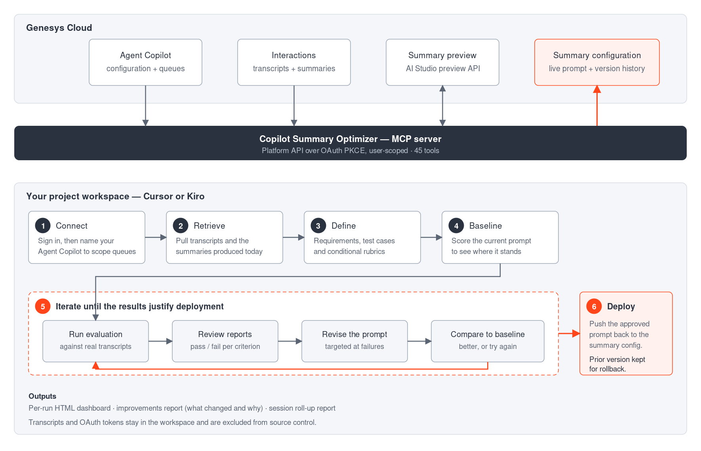

:::{"alert":"primary","title":"About Genesys Cloud Blueprints","autoCollapse":false} Genesys Cloud blueprints are intended to help you jump-start an integration or application. They show one practical implementation path and are not production-ready, turn-key solutions.

For more details on Genesys Cloud blueprint support and practices, see the Genesys Cloud blueprint FAQ. :::

This blueprint provides the Copilot Summary Optimizer, a Model Context Protocol (MCP) server that connects an AI coding assistant to the Genesys Cloud Platform API so you can test and improve Agent Copilot summary prompts against your own interaction data. It retrieves transcripts and existing summaries for a chosen Agent Copilot configuration, helps you author business requirements and test cases, runs repeatable evaluations with scoring rubrics, and reports on where a prompt succeeds or fails. You then iterate on the prompt and deploy an approved candidate back to the summary configuration, with the replaced version retained so you can roll back. The whole pipeline is driven in natural language from within Cursor or Kiro.



## Scenario

Writing a custom Agent Copilot summary prompt is straightforward. Knowing whether it works is not.

Teams typically change a prompt, look at a handful of summaries, and form an impression. That approach misses the cases that matter most: transferred interactions, unresolved issues, conflicting information from the customer, noisy transcripts, and conversations where a required downstream field simply cannot be derived from what was said. A prompt that looks fine on five clean calls can fail systematically on the tenth.

This blueprint replaces that with a measurable loop. You state what the summary must contain, express those statements as test cases with pass and fail criteria, score existing output to establish a baseline, then iterate until the results justify deployment.

## Contents

* [Solution components](#solution-components "Goes to the Solution components section")
* [Software development kits](#software-development-kits "Goes to the Software development kits section")
* [Prerequisites](#prerequisites "Goes to the Prerequisites section")
* [Implementation steps](#implementation-steps "Goes to the Implementation steps section")
* [Additional resources](#additional-resources "Goes to the Additional resources section")

## Solution components

* **Copilot Summary Optimizer MCP server** - A single-file Node.js MCP server exposing 45 tools that cover authentication, interaction filtering, transcript and summary retrieval, evaluation runs, report generation, and summary configuration updates.
* **Pipeline guidance** - Always-applied instructions that teach the coding assistant the order of operations, so you drive the pipeline conversationally rather than by calling tools by name.
* **Genesys Cloud Agent Copilot** - The Genesys Cloud feature whose summary configuration this solution reads, tests against, and updates.
* **AI Studio summary configuration** - Holds the custom summary prompt. The solution reads the active prompt, generates preview summaries from it, and writes approved candidates back.
* **HTML evaluation reports** - Self-contained run dashboards, an improvements report tracking what changed between runs and why, and a roll-up report summarizing a completed session.
* **Host editor** - Cursor or Kiro provides the AI coding assistant that orchestrates the pipeline.

## Software development kits

This solution calls the Genesys Cloud Platform API directly over HTTPS and does not depend on a Genesys Cloud SDK. The MCP server is written in TypeScript and distributed as a pre-built single-file bundle, so no build step is required to use it.

* **Model Context Protocol** - The open protocol the server implements to expose its tools to a host editor. For more information, see [modelcontextprotocol.io](https://modelcontextprotocol.io "Goes to the Model Context Protocol site").

## Prerequisites

### Specialized knowledge

* Administrator-level knowledge of Genesys Cloud, including OAuth client creation
* Familiarity with Agent Copilot and AI Studio summary configurations
* Working knowledge of an AI coding assistant (Cursor or Kiro)
* No programming is required to run the pipeline. Modifying the server itself requires TypeScript experience.

### Genesys Cloud account

* A Genesys Cloud license that includes Agent Copilot, with at least one configured Agent Copilot and summary configuration
* Interactions already processed by that Agent Copilot, so there are transcripts and summaries to test against
* An account with permission to create OAuth clients and to view and update summary configurations

### Software

* Node.js 18 or later
* Cursor, or Kiro with `kiro-cli`

:::{"alert":"warning","title":"Editor support","autoCollapse":false} Cursor is the recommended and most thoroughly tested host. Kiro is supported, and evaluation runs there require `kiro-cli chat` rather than the KiroCrew dashboard, because the dashboard agent cannot spawn the scoring subagents an evaluation run fans out to. :::

### OAuth scopes

Create a Code Authorization grant OAuth client with redirect URI `http://localhost:8787/callback`. No client secret is needed; the solution uses the Authorization Code with PKCE user login flow, so all API calls are made as the signed-in user with that user's permissions.

Add all eight scopes below. A missing scope blocks specific tools, sometimes in ways that are not obvious.

| Scope | Why it is needed |
| --- | --- |
| `ai-studio` | Summary configuration CRUD and preview summary generation |
| `analytics` | Conversation search and communication ID resolution |
| `assistants` | Agent Copilot configuration, including queue associations |
| `conversations` | Messaging transcript retrieval fallback |
| `notifications` | The preview API delivers results over a WebSocket notification channel |
| `routing:readonly` | Resolves queue display names from IDs |
| `speech-and-text-analytics:readonly` | Transcript retrieval and existing summary retrieval |
| `users:readonly` | Resolves the current user ID for WebSocket topic construction |

## Implementation steps

### Create the OAuth client

1. In Genesys Cloud Admin, go to **Integrations** > **OAuth** > **Add Client**.
2. Name the client, select the **Code Authorization** grant type, and set the redirect URI to `http://localhost:8787/callback`.
3. On the **Scope** tab, add all eight scopes listed above. Search for each name in the scope picker rather than typing it.
4. Save the client, reopen it, and copy the **Authorization URL** field in full. This is the only value you need; the client ID and region are extracted from it.

### Deploy the tooling to a project

1. Create an empty project folder and open it as the workspace root in Cursor or Kiro.
2. Open the built-in terminal, which starts in the workspace root.
3. Clone this repository into the project and run the deploy script:

```bash
git clone https://github.com/GenesysCloudBlueprints/copilot-summary-optimizer-mcp-blueprint.git copilot-summary-optimizer-mcp
node copilot-summary-optimizer-mcp/deploy.js
```

4. Answer the editor prompt. The script writes configuration for only the editor you select, and extends the project's `.gitignore` to exclude credentials and working data.
5. On Cursor, run **Developer: Reload Window**, then open **Customize** > **MCPs** and toggle `copilot-summary-optimizer` on. It should report 45 tools. On Kiro no action is needed; run `/mcp` in a chat to confirm.

Deploy at project scope rather than user scope. The server exposes 45 tools and always-applied guidance, which you do not want loaded into unrelated work.

### Authenticate

Open a new chat in the project and say `begin`. The assistant checks whether you have an OAuth client, walks you through creating one if not, asks for your Authorization URL, and completes the browser login. It then verifies all eight scopes before continuing.

### Run the pipeline

1. **Build an interaction filter.** Give the assistant your Agent Copilot name. It resolves the associated queues, retrieves the active summary configuration, and creates the working folder structure.
2. **Retrieve data.** The assistant downloads transcripts and existing summaries in bulk and converts transcripts into the format the preview API expects.
3. **Author requirements.** State what each summary must contain, ideally alongside the downstream destination fields. Supply good and bad examples where you have them.
4. **Create test cases and rubrics.** Requirements become scored test cases. Use conditional rubrics for criteria that only apply in certain situations, such as a transfer or an unresolved issue.
5. **Establish a baseline.** Score the existing summaries against the requirements to see where the current prompt stands.
6. **Iterate.** Run the evaluation, review the run dashboard and improvements report, apply the suggested prompt changes, and run again. Repeat until results justify deployment.
7. **Deploy.** Push the approved prompt into the summary configuration. The replaced prompt is retained in version history for rollback.
8. **Report.** Generate a roll-up report summarizing what changed across the session and the results achieved.

### Review the output

Each evaluation run produces a self-contained HTML dashboard with per-test-case results, an improvements report explaining what changed between runs and why, and on completion a roll-up report for the session as a whole. These are plain files in the project and can be shared as-is.

## Data handling

Working data is written to the workspace you have open, never to the install location.

* `summaryconfig-lifecycle/` holds transcripts, test cases, evaluation runs, and version history. Transcripts contain customer PII.
* `.copilot-summary-optimizer/` holds OAuth tokens.

The deploy script adds both to the project's `.gitignore`. Do not commit either. Tokens are user-scoped and expire in roughly 30 minutes, after which any API call reopens the browser to re-authenticate.

The two tools that write to live Genesys Cloud, `update_summary_setting` and `update_copilot_config`, are deliberately excluded from pre-approval on both hosts and always require explicit confirmation. On Kiro the evaluation scoring subagent has them removed outright, so a scoring stage cannot reach live Genesys Cloud even by mistake.

:::{"alert":"warning","title":"Trust settings","autoCollapse":false} Leave the host's trust setting on its normal level. Options such as Cursor's YOLO mode or Trust all tools override the per-tool scoping this solution relies on, including the confirmation step on the two tools that write to live Genesys Cloud. :::

## Additional resources

* [About Genesys Agent Copilot](https://help.genesys.cloud/articles/about-genesys-agent-copilot/ "Goes to the About Genesys Agent Copilot article") in the Genesys Cloud Resource Center
* [Platform API overview](https://developer.genesys.cloud/platform/api/ "Goes to the Platform API overview page") in the Genesys Cloud Developer Center
* [Grant - Proof Key for Code Exchange (PKCE)](https://developer.genesys.cloud/authorization/platform-auth/use-pkce "Goes to the PKCE grant page") in the Genesys Cloud Developer Center
* [Model Context Protocol specification](https://modelcontextprotocol.io "Goes to the Model Context Protocol site")
* Repository guides: `docs/setup.md`, `docs/oauth-setup.md`, `docs/workflow.md`, `docs/eval-guide.md`, `docs/requirements-guide.md`, and `docs/test-case-guide.md`
* [copilot-summary-optimizer-mcp-blueprint](https://github.com/GenesysCloudBlueprints/copilot-summary-optimizer-mcp-blueprint "Goes to the repository") repository in GitHub
